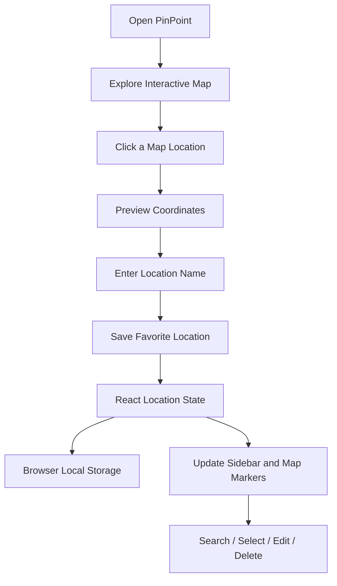

::: {align="center"}
``{=html}

### 📍 Interactive Favorite Location Manager

**Mark the places that matter. Keep them organized. Find them on the
map.**

` `{=html}

` `{=html}

``{=html}
:::🌍 About PinPoint
PinPoint is a responsive web application that helps users save,
organize, and revisit their favorite locations through an interactive
map interface.

Instead of remembering coordinates or searching for the same places
repeatedly, users can simply click on the map, give a location a name,
and save it to their personal list.

Built with React, Leaflet, and OpenStreetMap, PinPoint brings map
interaction and simple location management together in one clean
workspace.
The idea behind PinPoint: Make saving and managing meaningful
places simple, visual, and accessible.

✨ Features
<table>
<tr>
<td width="50%" valign="top">
📍 Add Favorite Locations
- Click anywhere on the map to choose a point.
- Preview the selected coordinates.
- Give the place a custom name.
- Save it to your location list.
</td>
<td width="50%" valign="top">
🗺️ Interactive Map
- Explore an OpenStreetMap map.
- View saved places with custom numbered markers.
- Select a marker to view its details.
- Automatically move the map to a selected location.
</td>
</tr>
<tr>
<td width="50%" valign="top">
🔎 Search & Explore
- Search saved locations by name.
- Quickly find a previously saved place.
- Select a result to focus on its map marker.
- View latitude and longitude.
</td>
<td width="50%" valign="top">
✏️ Edit & Delete
- Rename saved locations.
- Delete places with a confirmation dialog.
- Receive feedback through toast notifications.
- Keep the location list organized.
</td>
</tr>
<tr>
<td width="50%" valign="top">
📡 Locate Me
- Use the browser's Geolocation API.
- Find and display your current position.
- Move the map to your detected location.
- Handle permission and location errors.
</td>
<td width="50%" valign="top">
💾 Persistent Local Storage
- Save favorite locations in browser local storage.
- Restore saved locations when the app is reopened.
- Validate stored location data before loading.
- No account required for local use.
</td>
</tr>
</table>
🖥️ Application Highlights
  Area                  What it provides
  Header                PinPoint branding and saved-location count
Sidebar               Saved locations, search, and selected-place details
Map View              Interactive map, markers, and location selection
Add Location Modal    Location name and selected coordinates
Edit Location Modal   Rename an existing saved place
Delete Confirmation   Confirmation before removing a location
Locate Me Button      Browser-based current-location detection
Toast Notifications   Feedback for successful actions and errors
🧰 Tech Stack
::: {align="center"}
### Frontend

``{=html}

### Mapping & UI

``{=html}
:::  Technology                Purpose
  React 18                  Component-based user interface
JavaScript                Application logic and interactions
Vite 5                    Frontend development server and build tool
Tailwind CSS 3            Utility-first styling
Leaflet                   Interactive map rendering
React Leaflet             React components for Leaflet maps
OpenStreetMap             Map tile data
Lucide React              Interface icons
Browser Local Storage     Persisting saved locations
Browser Geolocation API   Detecting the user's current location
🏗️ Project Structure
PinPoint/
│
├── public/
│
├── src/
│   ├── assets/
│   │
│   ├── components/
│   │   ├── AddLocationModal.jsx
│   │   ├── DeleteConfirmDialog.jsx
│   │   ├── EditLocationModal.jsx
│   │   ├── EmptyState.jsx
│   │   ├── Header.jsx
│   │   ├── LocateMeButton.jsx
│   │   ├── LocationCard.jsx
│   │   ├── LocationList.jsx
│   │   ├── MapView.jsx
│   │   ├── SearchBar.jsx
│   │   ├── SelectedLocation.jsx
│   │   ├── Sidebar.jsx
│   │   └── Toast.jsx
│   │
│   ├── hooks/
│   │   └── useLocations.js
│   │
│   ├── utils/
│   │   ├── colors.js
│   │   └── storage.js
│   │
│   ├── App.jsx
│   ├── App.css
│   ├── index.css
│   └── main.jsx
│
├── index.html
├── package.json
├── tailwind.config.js
├── postcss.config.js
├── vite.config.js
└── README.md
⚙️ Getting Started
Follow these steps to run PinPoint on your local machine.
📋 Prerequisites
Make sure you have installed:
- Node.js (includes npm)
- npm (comes with Node.js)
- Git (optional, for cloning the repository)
1. Clone the repository
git clone <YOUR_GITHUB_REPOSITORY_URL>
Move into the project directory:
cd PinPoint/project
If your GitHub repository has the project files directly in its root,
simply run cd PinPoint instead.

2. Install dependencies
npm install
3. Start the development server
npm run dev
4. Open the application
Open the local URL displayed in your terminal by Vite. It is usually:
http://localhost:5173
🎉 That's it! PinPoint is ready to explore.
🧭 How to Use PinPoint
1. Explore the map --- Navigate around the map to find a place you
   want to save.
2. Add a location --- Click the map at the desired point. Enter a
   name in the dialog and save it.
3. View saved places --- Your saved locations appear in the sidebar
   and as numbered map markers.
4. Search locations --- Type a location name into the search field
   to filter your saved list.
5. Select a place --- Choose a location from the list or click its
   map marker to view its details.
6. Edit or delete --- Rename a saved place or remove it after
   confirmation.
7. Locate yourself --- Select the location button on the map and
   allow browser location permission.
🧩 How It Works

Location Data
Each saved location is represented by an object containing:
{
  id: "unique-location-id",
  name: "Favorite Place",
  latitude: 13.0827,
  longitude: 80.2707
}
The application stores the location list in browser local storage using
the key:
pinpoint-favorite-locations
📱 Responsive Experience
PinPoint includes a responsive layout for desktop and mobile screens.
- Desktop: A persistent location sidebar alongside the interactive
  map.
- Mobile: A collapsible location drawer with quick access to
  adding a place.
- Map controls: Location selection and map interactions remain
  accessible across screen sizes.
🔐 Privacy & Location Permissions
- Saved favorite locations are stored in the browser's local storage.
- The application uses browser geolocation only when the user
  activates the Locate Me feature.
- The browser may request permission before sharing the current
  location.
- Location access can fail if permission is denied, the position is
  unavailable, or the request times out.
- The map uses OpenStreetMap tile services, which require an internet
  connection.
Note: Local storage is browser-specific. Saved locations are not
automatically synchronized across devices or browsers.
🛠️ Available Scripts
  Command             Description
  npm run dev       Start the Vite development server
npm run build     Create a production build
npm run preview   Preview the production build locally
npm run lint      Run ESLint checks
🗺️ Map Attribution
Map tiles are provided by
OpenStreetMap contributors.

Please see the OpenStreetMap Copyright and
Attribution page for licensing
and attribution information.
🌱 Project Vision
PinPoint is built around a simple idea: the places we care about should
be easy to save, find, and revisit.

This project brings together interactive mapping, reusable React
components, browser APIs, and local data persistence to create a
practical location-management experience.
::: {align="center"}
## 📍 PinPoint

### Save Places. Find Your Way.

*Every place has a point. Make yours memorable.*

` `{=html}

``{=html}
:::
